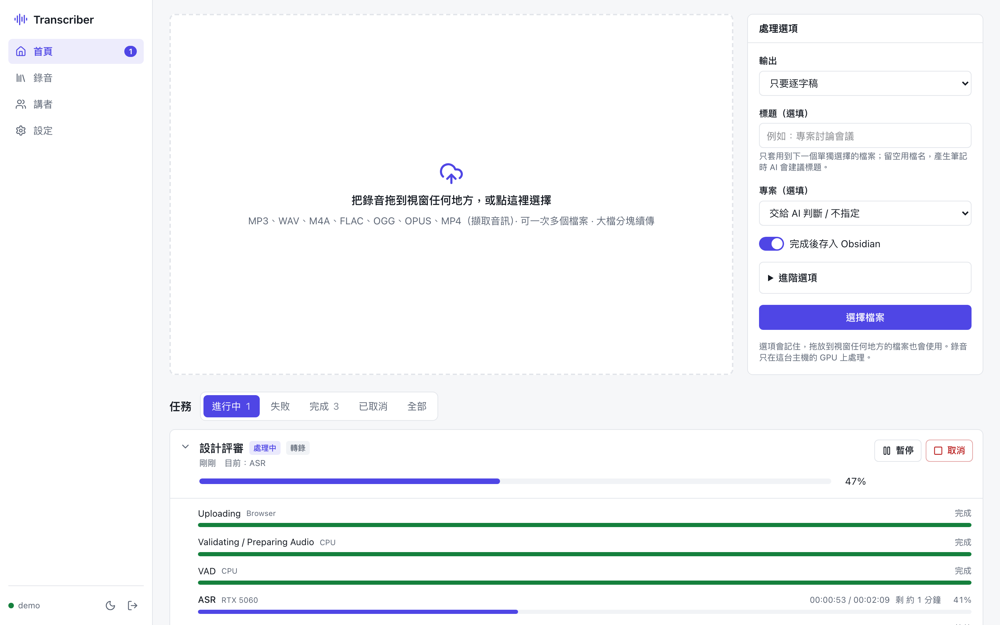
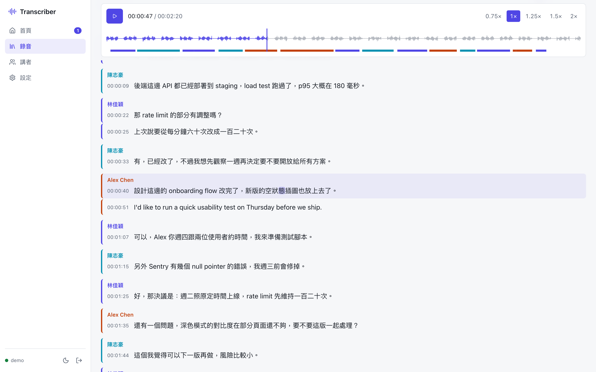
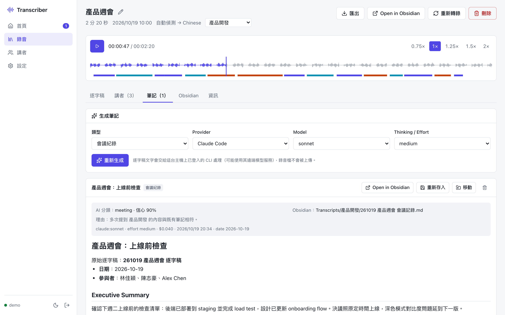
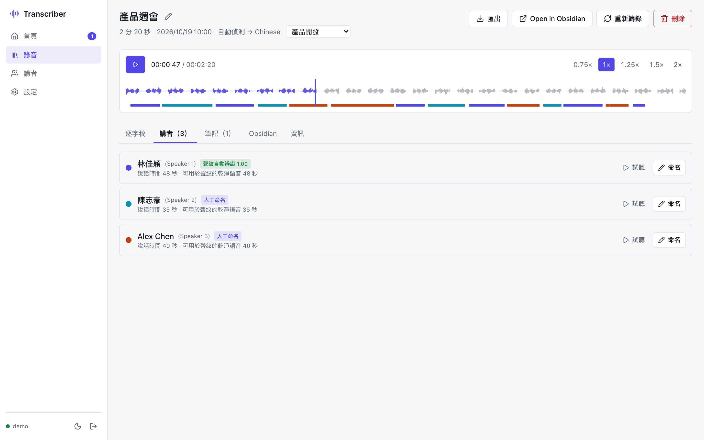
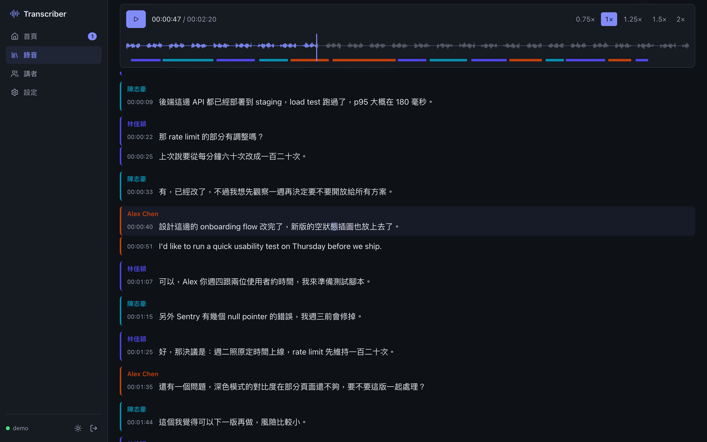
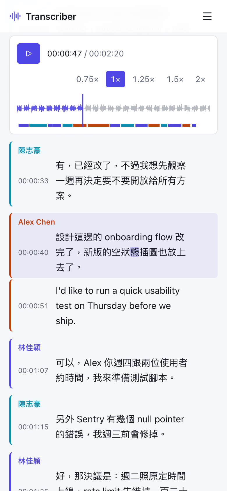

# Transcriber

在自己的 GPU 主機上轉錄會議、課程與訪談錄音：語音辨識、字詞時間對齊、講者分離與跨錄音講者辨認全部在本機執行；需要時再透過主機上已登入的 Claude Code CLI 或 Codex CLI 產生會議紀錄／上課筆記，並自動歸檔到 Obsidian vault。

**錄音不會離開主機。** 產生筆記時只有逐字稿文字會交給 CLI（CLI 可能使用其設定的遠端模型）。

| 模型 | 用途 | 裝置 |
| --- | --- | --- |
| [Silero VAD](https://github.com/snakers4/silero-vad)（ONNX） | 語音區段偵測 | CPU |
| [Qwen/Qwen3-ASR-1.7B-hf](https://huggingface.co/Qwen/Qwen3-ASR-1.7B-hf) | 語音辨識（中／英／中英混用，自動偵測語言） | GPU A |
| [Qwen/Qwen3-ForcedAligner-0.6B-hf](https://huggingface.co/Qwen/Qwen3-ForcedAligner-0.6B-hf) | 字詞級時間戳 | GPU A |
| [nvidia/Nemotron-3-Diarization](https://huggingface.co/nvidia/Nemotron-3-Diarization) | 講者分離（最多 8 人，speaker cache 串流） | GPU B |
| [nvidia/speakerverification_en_titanet_large](https://huggingface.co/nvidia/speakerverification_en_titanet_large) | 聲紋，跨錄音認出同一個人 | CPU |

## 截圖

> 以下截圖使用 `scripts/demo/server.mts` 產生的虛構資料（虛構的人名、對話與筆記，合成音訊）。

首頁：拖放上傳（整個視窗都可以放）、處理選項、即時任務進度（每個階段都依實際處理量計算）



逐字稿：播放器固定在上方，點文字跳到該時間，播放時標示目前的句子與字詞，依講者上色



AI 會議紀錄（結構化輸出，只列有逐字稿證據的決議、負責人與期限）與自動歸檔建議



講者：聲紋自動辨識已知的人，也可以手動命名並註冊聲紋



| 深色模式 | 手機 |
| --- | --- |
|  |  |

## 功能

- **上傳**：多檔、拖放、分塊續傳（8 / 16 / 32 MiB chunk，每塊 SHA-256 驗證、單塊重試、暫停／繼續、重新整理後選回同一檔案即可續傳），伺服器以串流組合並驗證完整性。
- **任務佇列**：SQLite 持久化；每個階段有狀態、進度、開始／結束時間、錯誤、重試次數；暫停在安全的區段邊界並從 checkpoint 繼續；取消會停止 worker 並釋放 GPU；伺服器重啟或當機後自動恢復，不會卡在 running。
- **GPU-aware 排程**：每張 GPU 同時只跑一個重型階段；ASR／對齊與講者分離在兩張卡上平行；OOM 自動重試，講者分離可退回 CPU（UI 會標示）。
- **逐字稿檢視**：波形、播放速度、搜尋、編輯文字與講者（保留原始模型輸出與修訂紀錄）、重疊發言與不確定講者明確標示、匯出 TXT／Markdown／JSON／SRT／VTT。
- **筆記**：會議紀錄、上課筆記；Claude Code（`claude -p`）或 Codex（`codex exec`），可選模型與 thinking／reasoning effort。CLI 以最低權限執行，逐字稿視為不可信輸入。
- **Obsidian**：寫入本機 vault 目錄，或經由會寫入 vault 的 MCP server（例如 LiveSync bridge）；AI 判斷文件類型與所屬專案，只有信心夠高才自動歸檔，否則放「待整理」；逐字稿與筆記互相 `[[連結]]`；同名檔案不會被默默覆蓋。
- **資料管理**：分別刪除原始錄音／逐字稿／筆記／整筆錄音／聲紋，預設不刪 Obsidian 檔案；磁碟用量與自動清理設定。

## 架構

```
Browser (React + Vite + Tailwind)
  │  REST + SSE（HTTPS 由反向代理處理）
  ▼
Fastify API（Node 22）── SQLite（WAL）── data/recordings/<id>/…
  ├─ Scheduler：lane、lease、checkpoint、pause / resume / cancel
  │    ├─ gpu-asr  → Python worker（CUDA_VISIBLE_DEVICES=<GPU A UUID>）ASR + 對齊
  │    ├─ gpu-diar → Python worker（CUDA_VISIBLE_DEVICES=<GPU B UUID>）講者分離
  │    ├─ cpu      → Python worker：Silero VAD、TitaNet
  │    ├─ ffmpeg   → 解碼、16 kHz、音量正規化、波形
  │    └─ llm      → claude -p / codex exec
  └─ Obsidian：filesystem 或 MCP 後端
```

- 所有時間都是原始錄音的毫秒座標。VAD 依停頓切出 ASR 區段（≤ 28 秒，過長在最安靜處切開），和 HTTP 上傳 chunk 完全無關。
- 講者分離對整份錄音串流處理（模型卡的 offline 設定：chunk 340 + right context 40），ASR 怎麼切段都不會讓講者重新編號。
- 每個字詞的講者以字詞時間與講者區間的**實際重疊長度**決定；重疊發言、沒有講者覆蓋的段落會明確標示，不會硬塞給某個人。
- 小聲、遠距的講者容易被 VAD 漏掉，所以 VAD／ASR／對齊使用 `speechnorm` 音量正規化的副本（講者分離與聲紋仍用原音訊）。

```
server/   Fastify + TypeScript：API、scheduler、各處理階段、CLI adapter、Obsidian 整合、測試
worker/   Python AI worker（JSON-lines 協定，一個 lane 一個行程）與 pytest
web/      React SPA（由 Fastify 提供靜態檔）
deploy/   install.sh、systemd unit 範本、Caddy 設定範例
scripts/  dev.sh、acceptance.mjs（真實模型驗收）、worker_e2e.py、download_models.py、demo/
docs/     TEST_REPORT.md、screenshots/
```

## 需求

- Linux（以 Ubuntu 24.04 測試）、NVIDIA driver（支援 CUDA 13.x）、`ffmpeg`、Node.js ≥ 22、pnpm、[uv](https://github.com/astral-sh/uv)
- 兩張 NVIDIA GPU 最理想（一張 ASR + 對齊、一張講者分離），單卡也可以（兩個 lane 指到同一張卡，或講者分離改用 CPU）
- 選用：已登入的 [Claude Code](https://code.claude.com/docs/en/cli-reference) 或 [Codex](https://github.com/openai/codex) CLI（產生筆記）

### 測試環境

| | |
| --- | --- |
| GPU | NVIDIA GeForce RTX 5060 8 GB（Blackwell，sm_120）＋ RTX 3050 6 GB（Ampere，sm_86） |
| Driver / CUDA | 595.99 / 13.2 |
| PyTorch | 2.12.0+cu132（同時支援 sm_86 與 sm_120） |
| Transformers / NeMo | 5.20.1 / 3.0.0 |
| 其他 | Python 3.12、silero-vad 6.2.3、onnxruntime 1.31、Node 22、Fastify 5、React 19、Vite 7、Tailwind 4 |

實測（RTX 5060 ＋ RTX 3050）：81 分鐘英文課程 ASR 約 7 分鐘；53 分鐘錄音的講者分離約 15 秒；ASR 與對齊模型同時常駐約 5.7 GB VRAM。詳見 [docs/TEST_REPORT.md](docs/TEST_REPORT.md)。

> PyPI 上的 `nemo-toolkit 3.0.0` 還無法載入 Nemotron-3-Diarization（不支援其 `rope` 位置編碼），所以講者分離使用模型卡列出的 Transformers 原生實作；NeMo 只用於 TitaNet。

## 安裝

```bash
git clone https://github.com/elvisdragonmao/transcriber.git
cd transcriber
./deploy/install.sh
```

`install.sh` 會：建立 `worker/.venv`（torch cu132）並安裝依賴、下載模型（全部公開，不需 Hugging Face token）、build 前端與後端、從 `.env.example` 產生 `.env`（隨機管理員密碼，`grep ADMIN_PASSWORD .env`）、執行 migration，並以目前使用者安裝、啟動 `transcriber.service`（systemd，開機自動啟動、失敗自動重啟）。之後更新只要 `git pull && ./deploy/install.sh --no-models`。

設定項目在 `.env`（伺服器、帳號、CLI 路徑、Obsidian MCP）與網頁的「設定」（GPU 對應、模型參數、LLM、Obsidian vault、上傳與並行、儲存空間）。

### HTTPS 與網路

服務只綁定 `127.0.0.1:8000`，請放在反向代理後面。`deploy/Caddyfile.snippet` 是 Caddy 範例；如果主機名稱解析到私有／VPN 位址，可以用 Cloudflare DNS-01 取得憑證（`deploy/install-caddy.sh` 安裝含 `caddy-dns/cloudflare` 的 Caddy，不覆蓋套件版本）。`LAN_ONLY=1` 會拒絕私有網段與 CGNAT（100.64.0.0/10）以外的連線。

### 開發

```bash
pnpm install
MOCK_WORKER=1 ./scripts/dev.sh        # 不需要 GPU：假 worker；API :8000 + Vite :5173
pnpm --filter server test             # 45 項整合／單元測試（mock worker + 真實 ffmpeg）
(cd worker && .venv/bin/python -m pytest)
node scripts/acceptance.mjs --file meeting.m4a --template meeting   # 真實模型驗收
cd server && npx tsx ../scripts/demo/server.mts 8100                 # 虛構資料 demo（demo / demo-password）
```

## 安全性

- 帳號密碼（scrypt）＋ `HttpOnly; SameSite=Strict` session；所有 API 需登入；登入失敗鎖定；同源 CORS ＋ Origin 檢查；CSP 等安全標頭。
- 上傳：副檔名／MIME 白名單、大小與磁碟空間檢查、每塊 SHA-256、使用者綁定的 session、檔名只當 metadata（實際路徑由伺服器產生）。
- 子程序（ffmpeg、Python、Claude、Codex）一律以參數陣列 `spawn`，有逾時、輸出上限，取消時終止整個 process group。
- LLM CLI 最低權限：Claude `--tools ""`、`--strict-mcp-config`、`--safe-mode`、`--no-session-persistence`、`--max-budget-usd`；Codex `--sandbox read-only`、`--ephemeral`、`--ignore-user-config`；每次在新的空目錄執行，只帶必要環境變數；每日呼叫上限。
- 逐字稿放在 `<transcript>` 中並標示為不可信資料；輸出受 JSON Schema 約束並由後端驗證；模型字串轉成 inert Markdown，前端再用 DOMPurify；Obsidian 路徑只由後端決定，且限制在允許的資料夾內。
- 日誌遮罩 cookie／authorization／body，不記錄錄音內容、逐字稿或筆記文字。

## 已知限制

- TitaNet 以英文資料訓練，中文聲紋分數可靠度較低；中文自動命名門檻預設 0.78（英文 0.72）且要求與第二名差距 ≥ 0.10，建議累積人工確認的資料後用 `GET /api/speakers/calibration` 校準。
- ASR、對齊、聲紋會從 checkpoint 接續；VAD 與講者分離沒有可續跑的中間狀態，暫停後會重跑該階段（通常數十秒內）。
- 重新轉錄時，若音訊、VAD 切段、語言與 Vocabulary 都沒變，ASR 會直接沿用 checkpoint（解碼是 deterministic）。
